# Arrow Space Studio Website

A bilingual (Bahasa Melayu / English) single-page website for **Arrow Space Studio**, a mural art studio in
Kuala Lumpur, Malaysia.

> **Status: in development — not deployed.** The site is being built for a client who has not yet supplied
> all of the final company information, the official email address, the logo in its final form or the
> original portfolio photographs. Some details and images on the page are therefore **placeholders or
> previews** (see [Current status](#11-current-status-and-pending-client-information)). It has not been
> launched and has not completed its production handover.

## Contents

1. [Project overview](#1-project-overview)
2. [Objectives and audience](#2-objectives-and-audience)
3. [Features](#3-features)
4. [Technology stack](#4-technology-stack)
5. [UI previews](#5-ui-previews)
6. [Project structure](#6-project-structure)
7. [Local development](#7-local-development)
8. [Configuration and environment variables](#8-configuration-and-environment-variables)
9. [Testing and production build](#9-testing-and-production-build)
10. [Deployment](#10-deployment)
11. [Current status and pending client information](#11-current-status-and-pending-client-information)
12. [Credits, dependencies and licences](#12-credits-dependencies-and-licences)

## 1. Project overview

The studio paints hand-made murals — space and galaxy scenes, neon and UV-glow rooms, themed children's
rooms, portraits and characters. The website presents that work and lets visitors start an enquiry through
WhatsApp.

The page is a single route that is **pre-rendered to static HTML** at build time, so it can be hosted on any
static host. The design direction ("Cosmic Violet" palette, editorial type, trade-inspired graphic details)
is described in [docs/DESIGN.md](docs/DESIGN.md).

## 2. Objectives and audience

**Objectives**

- Show the studio's work clearly and let visitors browse it by theme.
- Explain how a commission works.
- Make a first enquiry quick: a WhatsApp-first flow with a prepared message, plus a brief builder.
- Keep all client content in a few configuration files so it can be updated without changing layout code.
- Stay honest while the client's final information is pending (demo/live switch, see [section 8](#8-configuration-and-environment-variables)).

**Intended audience**

- Homeowners and parents looking for a mural for a room, ceiling or feature wall.
- Cafés, shops, studios and other businesses commissioning a themed wall.
- Visitors in Malaysia, in Bahasa Melayu or English.

## 3. Features

Everything below is implemented in this repository. Where a claim is covered by an automated test, the test
suite is in `src/test/`. See [docs/PROJECT-STATUS.md](docs/PROJECT-STATUS.md) for what was checked and how.

**Implemented**

- **Sections:** hero, introduction, services, selected work, process, About (lead artist), social follow,
  testimonials, contact / enquiry, location with map, footer.
- **Selected work gallery:** 26 photographs with category filters (Galaxy, Characters, Portraits, Colour &
  Street, Behind the Scenes), responsive three/two/one-column grid and a project viewer built on the native
  `<dialog>` element (keyboard arrows, Escape, focus restored on close, swipe on touch).
- **Bilingual interface:** Bahasa Melayu and English with a header toggle, browser-language detection and a
  saved choice. Interface strings are typed so a missing translation fails the build and the tests.
- **WhatsApp quick-chat:** every WhatsApp button opens a panel with a greeting, a prepared message and quick
  replies; the visitor presses _Send on WhatsApp_ to open WhatsApp with the message filled in. Nothing is
  sent automatically.
- **Project brief builder:** a form that composes a structured message (project type, location, wall size,
  timeline, notes). On submit it opens WhatsApp with the message filled in, or the visitor can copy it. It
  does not post to a server.
- **Contact channels:** header top bar, mobile menu, sticky mobile enquiry bar, desktop contact dock, and a
  location section with an embedded Google Map and a directions link.
- **Process before/after slider:** a drag/keyboard range-input comparison component, also available for any
  portfolio project that has a "before" photo.
- **Responsive images:** a build script generates WebP sizes up to 2048 px and a manifest; the browser
  downloads only the size it needs.
- **Accessibility and motion:** skip link, semantic landmarks, visible focus, `prefers-reduced-motion`
  support, content that stays visible without JavaScript.
- **Content switches:** `contentStatus` (demo/live), `showSampleLabels`, `seo.indexable` and portfolio
  `status` values, described in [section 8](#8-configuration-and-environment-variables).
- **Search-engine settings:** page title, description, Open Graph and Twitter tags. The site is set to
  `noindex` until launch.

**Not implemented / planned**

- Email delivery of enquiries (no form back end exists).
- Analytics.
- Individual project pages.
- Lighthouse performance results, real-device testing and a screen-reader walkthrough have not been done.

## 4. Technology stack

Versions are taken from `package.json`.

- **React 19** and **TypeScript 5**
- **TanStack Start / Router** (file-based routes in `src/routes`), static prerender
- **Vite 8** and **Tailwind CSS 4** (design tokens in `src/styles.css`)
- **lucide-react** icons; animation uses CSS and `IntersectionObserver`, no animation library
- **Vitest 4** and **Testing Library** (jsdom) for tests
- **ESLint 9** and **Prettier** for linting and formatting
- **sharp** (development only) to generate responsive image sizes
- **Google Fonts** (Fraunces, Manrope, IBM Plex Mono), loaded from Google at runtime

## 5. UI previews

Genuine screenshots of the current build, captured in Microsoft Edge at 1440 × 900 (desktop) and 390 × 844
(mobile) against the local dev server on 2026-10-22. See [docs/screenshots/README.md](docs/screenshots/README.md).

> **Content in these screenshots is not final.** The portfolio photographs are the studio's own work taken
> from its public social pages and are shown as previews pending the owner's approval. The contact email
> shown on the page is a placeholder. The testimonials and client logos on the live page are stand-ins
> written for layout purposes only and are deliberately not shown here.

**Homepage / hero**

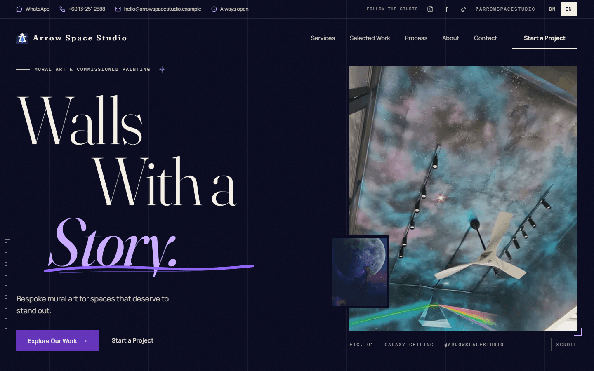

**Services**

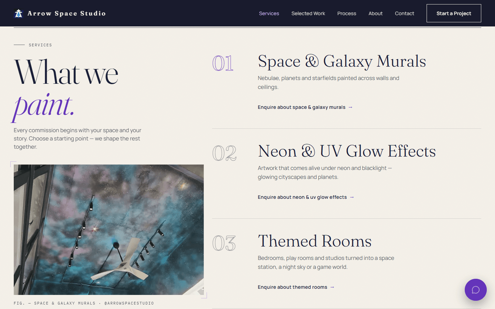

**Selected work (portfolio gallery)**

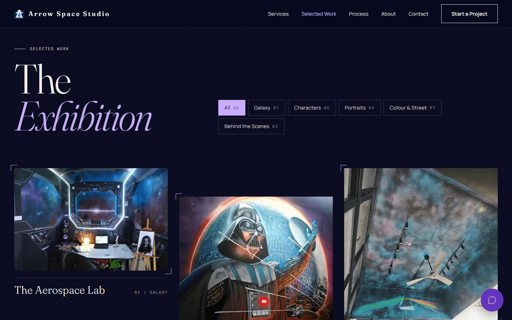

**Project viewer**

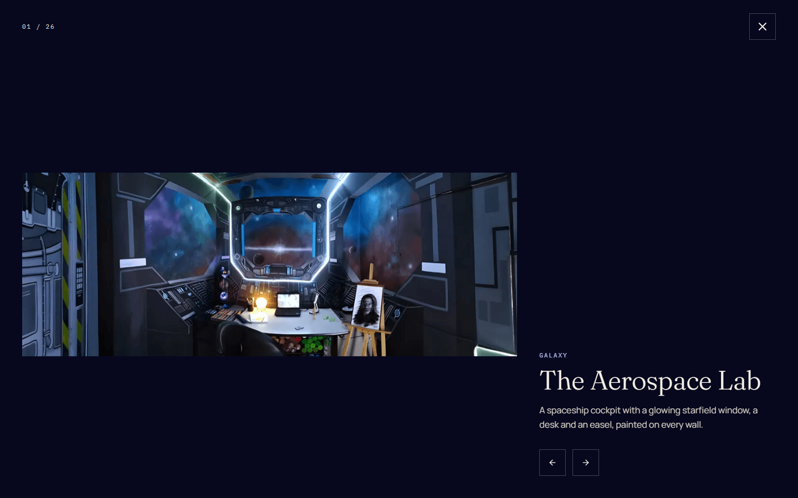

**Process**

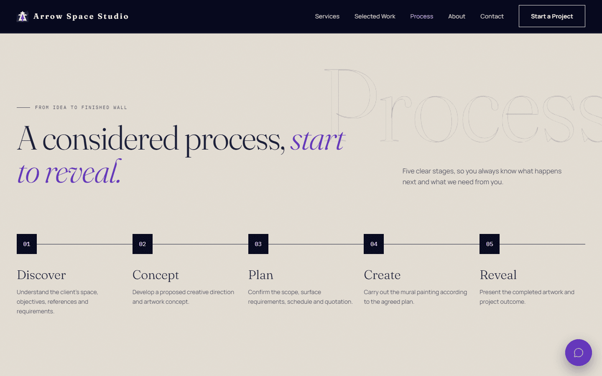

**About**

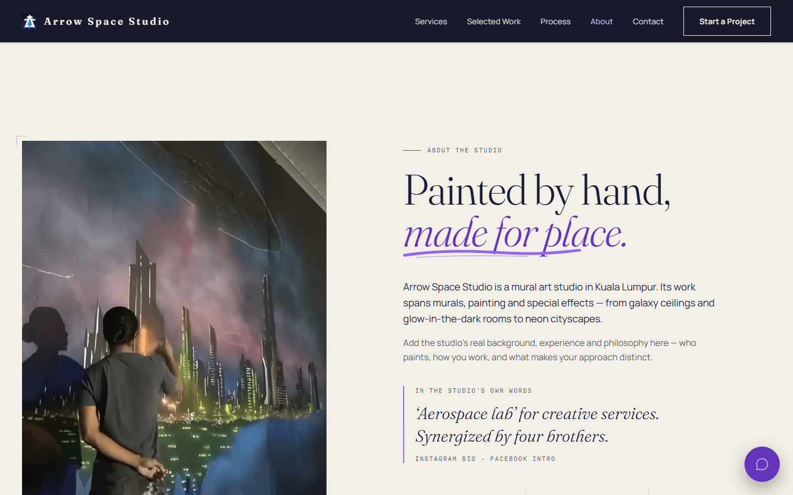

**Contact / project enquiry**

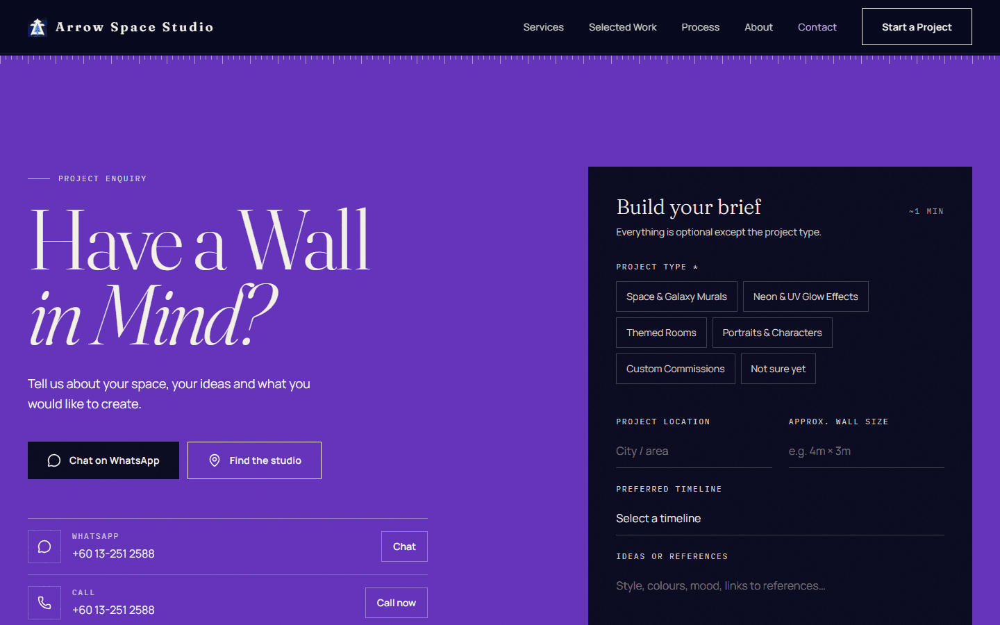

**WhatsApp quick-chat panel**

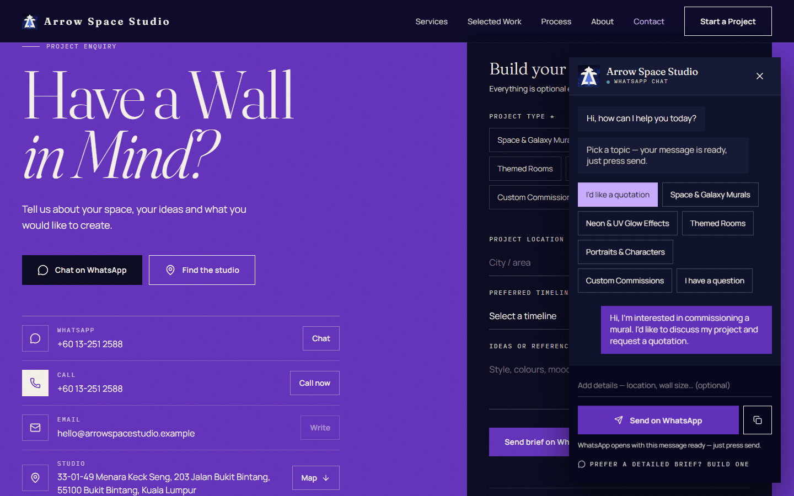

**Location and map**

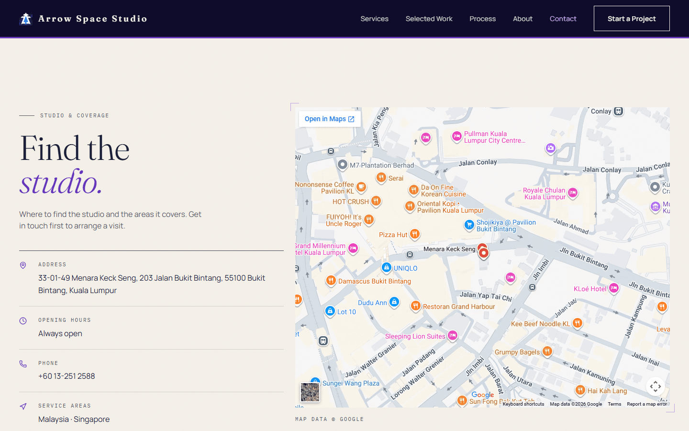

**Bahasa Melayu**


**Mobile**

<table>
  <tr>
    <td>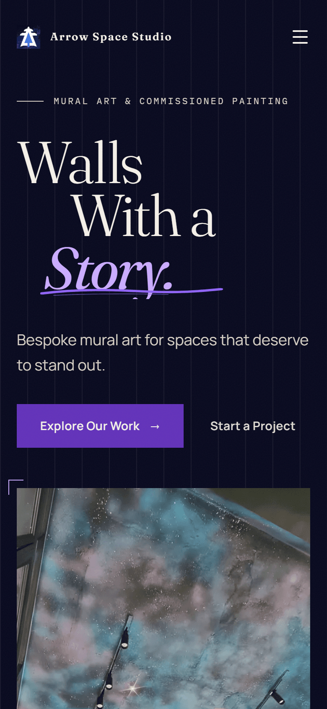</td>
    <td>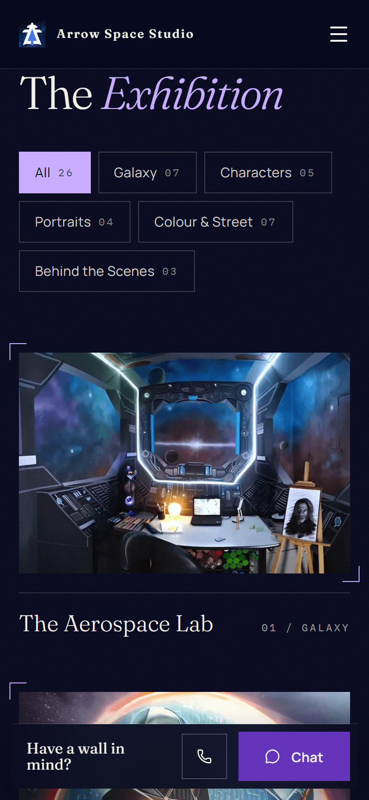</td>
  </tr>
</table>

## 6. Project structure

```
src/
  config/            Company details, page content, portfolio, testimonials, image registry
    business.ts        company details, WhatsApp, SEO, demo/live switch
    content.ts         navigation, services, process, About copy, chat quick replies
    portfolio.ts       the 26 gallery projects and their categories
    social-proof.ts    testimonials and client logos (stand-ins until real ones exist)
    images.ts          image registry (reads src/assets/web/manifest.json)
  components/site/   Page sections and shared UI (Hero, Services, Work, Lightbox, Process, About, Contact, ...)
  i18n/              Language store and all interface strings (English + Bahasa Melayu)
  lib/               WhatsApp message builder, chat state, contact helpers, motion, utilities
  routes/            __root.tsx (document head) and index.tsx (the page)
  assets/            Master photographs, brand logo, generated WebP sizes (assets/web), SOURCES.md
  test/              Unit and component tests
  styles.css         Design tokens, buttons, graphic details, motion
public/              Favicon, touch icon, Open Graph image, robots.txt
scripts/             optimize-images.mjs (responsive image generation)
docs/                Design notes, content guide, status, development tips, screenshots
netlify.toml         Static-hosting settings (not yet used for a deployment)
```

`src/assets/SOURCES.md` records where each photograph came from, how it was cropped or enhanced, and what
was removed for privacy.

## 7. Local development

Use a current **Node.js** release: Node 22 is what `netlify.toml` specifies, and the project was developed on Node 24.

```sh
npm install
npm run dev        # http://localhost:5173 with hot reload (the port is fixed)
```

Other commands:

```sh
npm run build      # static site -> dist/client
npm run preview    # serve the production build locally
npm run typecheck  # tsc --noEmit
npm run lint       # ESLint + Prettier check
npm test           # Vitest
npm run check      # typecheck + lint + tests + build
npm run images     # regenerate responsive images after adding or replacing photos
```

Tips for previewing inside VS Code are in [docs/DEVELOPMENT.md](docs/DEVELOPMENT.md).

## 8. Configuration and environment variables

**No environment variables are used**, and no `.env` file, API key or secret is needed to develop, build or
run the site. All configuration is in TypeScript files:

| File                         | What it controls                                                                                          |
| ---------------------------- | --------------------------------------------------------------------------------------------------------- |
| `src/config/business.ts`     | Company details, WhatsApp number, social profiles, address, map, SEO, `contentStatus`, `showSampleLabels` |
| `src/config/content.ts`      | Navigation, services, process steps, About text, chat quick replies, before/after pair                    |
| `src/config/portfolio.ts`    | Gallery projects, categories, per-project status                                                          |
| `src/config/social-proof.ts` | Testimonials and client logos                                                                             |
| `src/i18n/copy.ts`           | Fixed interface text in both languages                                                                    |

Important switches:

- `contentStatus: "demo" | "live"` — in `demo`, details the client has not supplied are replaced by obviously
  fake stand-ins; in `live` they are hidden, and the testimonials section disappears until real content exists.
- `showSampleLabels` — when `true`, draws "Sample" / "Proposed" / "Preview" tags next to stand-in details. It
  is currently `false`, so **stand-in values are not labelled on the page**; this README and
  [docs/PROJECT-STATUS.md](docs/PROJECT-STATUS.md) are where they are identified.
- `seo.indexable` and `seo.siteUrl` — currently `false` and empty; the page tells search engines not to index it.

The step-by-step content guide is [docs/OWNER-GUIDE.md](docs/OWNER-GUIDE.md).

## 9. Testing and production build

```sh
npm run check
```

Result on 2026-10-22 (commit `7f31b3b`): type-check passed, ESLint/Prettier passed, **79 tests in 9 files
passed**, and the production build and prerender succeeded (`dist/client` is about 9.8 MB, mostly responsive
images).

The tests cover the WhatsApp message builder, the chat panel, contact-channel handling, the bilingual
strings, portfolio data and gallery behaviour, social-proof handling, routing and the artist/About content.
They run in jsdom; they do not replace testing on real browsers and devices.

## 10. Deployment

**Current status: not deployed.** No hosting account has been connected and no public URL exists.

`netlify.toml` contains the intended static-hosting settings (build command `npm run build`, publish
directory `dist/client`, Node 22, security and caching headers). These settings have been checked against a
local build only; a Netlify deployment has not been attempted. No environment variables or server functions
are required.

Before any public launch: set `seo.siteUrl` and `seo.indexable`, replace `public/robots.txt` as described in
the file, switch `contentStatus` to `"live"` once the client's details are confirmed, and replace the
placeholder content listed below. The launch steps are in the "Going public" section of
[docs/OWNER-GUIDE.md](docs/OWNER-GUIDE.md).

## 11. Current status and pending client information

**Confirmed and in use**

- Company name, the Kuala Lumpur address and "Always open" hours as published on the studio's Facebook page.
- The studio logo supplied by the project owner (a JPEG with a starfield background).
- An owner-approved WhatsApp number, and the studio's Instagram, Facebook and TikTok accounts.

**Placeholders and previews currently on the page**

- The **contact email** shown in the header, contact section and footer is a placeholder on a reserved
  `.example` domain. It is not a clickable link.
- **Testimonials** (shown with initials only) and **client logos** are stand-ins written for layout. They are
  not real clients and must be replaced or removed before launch.
- The **Process before/after slider** uses AI-generated concept imagery, not studio work.
- The **portfolio photographs** are real work of the studio taken from its public social pages and shown as
  previews. Because the originals are small, they were enlarged with an AI upscaler (see
  [credits](#12-credits-dependencies-and-licences)); the added sharpness is reconstructed rather than
  captured.
- **Service list, process steps and About text** are proposed wording pending the client's approval.

**Needed from the client**

- A working business email address.
- Confirmation of service areas (Malaysia and/or Singapore), opening hours and whether to show the artist's
  full name and the "four brothers" line.
- The logo as a transparent SVG or PNG.
- **Original, approved portfolio photographs** with project details and permission for any
  client-identifying content (business names and signage appear on some walls).
- Written permission and wording for genuine testimonials, and permission to show client logos.
- A real before/after photo pair of one wall.
- The final domain name.
- Decisions on analytics and on an email form back end.

The fuller checklist is in [docs/PROJECT-STATUS.md](docs/PROJECT-STATUS.md).

## 12. Credits, dependencies and licences

**Code.** The source code in this repository is released under the [MIT Licence](LICENSE). The licence covers
the code only, not the images or the studio's name and logo.

**Photographs and brand assets.** The portfolio photographs, the logo and the studio's name belong to Arrow
Space Studio and its artists and are used here with the project owner's supplied material. They are not
covered by the MIT licence. Provenance, crops and privacy redactions (for example, children's names removed
from a flag and a car number plate cropped out) are recorded in
[src/assets/SOURCES.md](src/assets/SOURCES.md). Unmodified source versions are kept in
`src/assets/source-previews/`.

**AI-generated imagery.** The before/after sketch and its finished image in the Process section, and the
unused demo images in `src/assets/unused-demo/`, were AI-generated for the original template and are not the
studio's work.

**Image enhancement.** Portfolio photographs were enlarged with
[Real-ESRGAN](https://github.com/xinntao/Real-ESRGAN) (BSD 3-Clause), using the `realesrgan-ncnn-vulkan`
v0.2.5.0 release. Details are in `src/assets/SOURCES.md`.

**Third-party packages** (see `package.json` and `package-lock.json` for exact versions): React,
TanStack Start and Router, Vite, Tailwind CSS, `clsx`, `tailwind-merge`, `lucide-react` (ISC), Vitest,
Testing Library, ESLint, Prettier, TypeScript and `sharp` (Apache-2.0). Most are MIT-licensed; check each
package's own licence before redistributing.

**Fonts.** Fraunces, Manrope and IBM Plex Mono are open-source fonts (SIL Open Font Licence) served by
Google Fonts.

**Map.** The location map is a Google Maps embed (© Google).

## Further documentation

- [Content and configuration guide](docs/OWNER-GUIDE.md)
- [Project status and checklist](docs/PROJECT-STATUS.md)
- [Creative direction](docs/DESIGN.md)
- [Development tips (VS Code preview)](docs/DEVELOPMENT.md)
- [Image sources and processing](src/assets/SOURCES.md)
